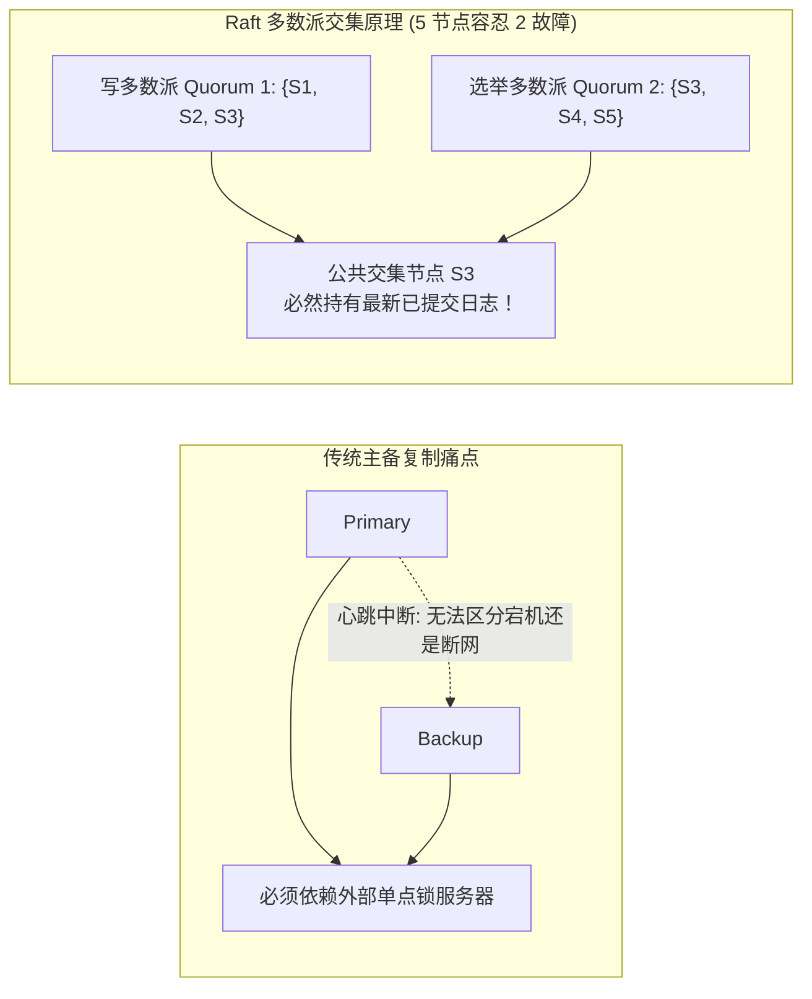
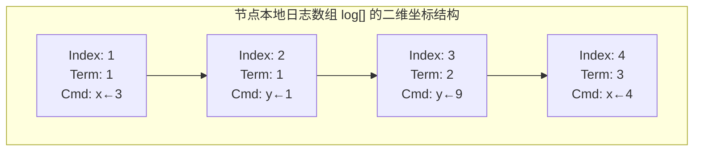
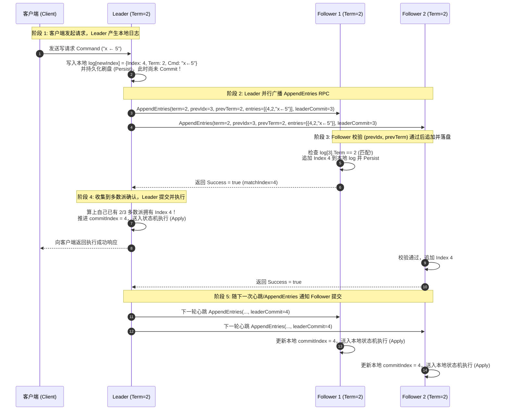
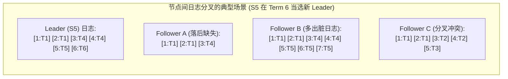
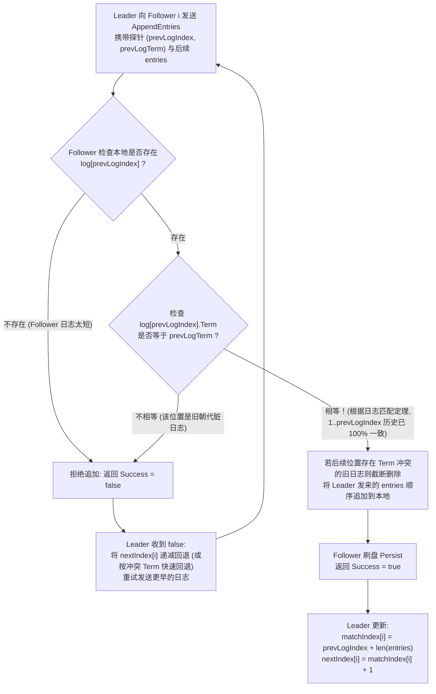
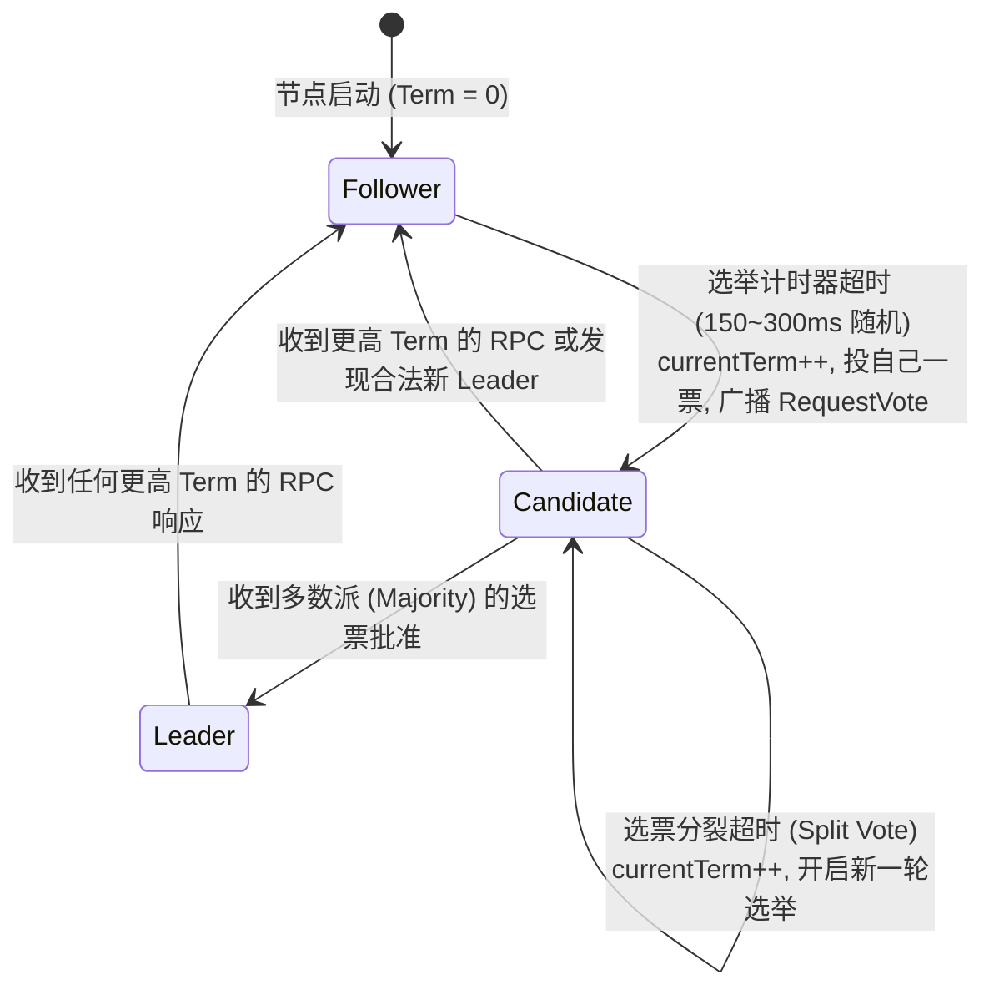
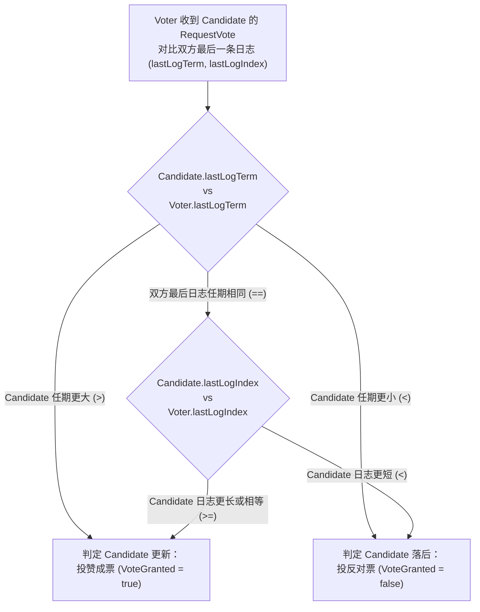
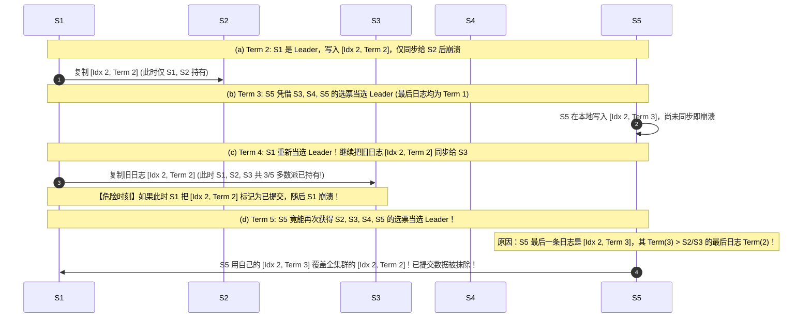

# LEC 05 - Raft 共识算法：选主、日志复制与安全性 (Part 1)

> **经典论文**：*In Search of an Understandable Consensus Algorithm (Extended Version)* (Diego Ongaro and John Ousterhout, Stanford University, USENIX ATC 2014)  
> **核心主题**：强领导者模型 (Strong Leader)、任期逻辑时钟 (Terms)、日志产生与复制同步 (`AppendEntries`)、一致性检查 (`prevLogIndex`/`prevLogTerm`)、选主限制 (Election Restriction) 与 Figure 8 安全性陷阱

---

## 1. 为什么需要 Raft？从主备复制到多数派共识

在 LEC 03 (VMware FT) 中，我们看到了双机主备复制的致命痛点：**一旦网络发生分区，单靠主备两台机器自己无法区分“对方死机”还是“网线断了”**，必须依赖外部第三方的共享存储原子锁 (Test-and-Set Server) 来避免脑裂 (Split-Brain)。但那个锁服务器本身又成了单点故障！

**Raft 的核心破局思想**：取消外部单点仲裁者，利用 **奇数个节点（$2f+1$）组成的集群** 与 **多数派法定人数（Majority Quorum, $f+1$）交集原理**，将选主与日志复制合二为一：

- **任何两个多数派集合至少存在一个公共重叠节点（Overlap Node）**。
- 新选出的多数派必然至少包含一个见证过旧多数派最新已提交数据的节点！

---

## 2. 核心解剖：日志 (Log)、任期 (Term) 与索引 (Index) 的关系

很多初学者在看选主限制时会困惑：**“日志里的 `Term` 到底是什么？为什么一条日志既要有 `Index` 又要有 `Term`？”**

### 2.1 一条日志条目 (Log Entry) 里装了什么？

在 Raft 中，每个节点维护一个按顺序追加的日志数组 `log[]`。每一条日志条目（Log Entry）由三个核心字段组成：

1. **`Index`（日志槽位索引）**：从 $1$ 开始严格递增的整数，代表这条指令在状态机历史序列中的**物理位置（第几步操作）**。
2. **`Term`（产生该日志时的任期号）**：代表**当时是哪一届 Leader 接收并创建了这条日志**。它是分布式系统中的**逻辑时钟（Logical Clock）**。
3. **`Command`（状态机指令）**：客户端请求的具体业务操作（例如 `Put("x", 10)`）。

### 2.2 为什么有了 `Index` 还不够，必须记录 `Term`？

如果集群永远不换主，只用 `Index = 1, 2, 3...` 就足够了。但在真实网络中，**老 Leader 可能在把日志同步给一部分节点后就崩溃了，新选出的 Leader 会产生新的日志**！

此时，在同一个 `Index` 位置上，不同节点可能存着**不同届 Leader 写入的不同指令**（即“日志分叉”）：

- 例如在 `Index = 3` 处，旧 Leader（`Term = 1`）曾在崩溃前写入了 `y ← 5`，只传给了自己；
- 新 Leader（`Term = 2`）当选后，在 `Index = 3` 处写入了 `y ← 9`。
- **`Term` 就是识别“哪条日志是旧朝代遗留的脏日志、哪条是新朝代权威日志”的唯一身份证！**

!!! important "Log Matching Property（日志匹配定理）"
    Raft 依靠 `(Index, Term)` 二元组维持两条铁律：

    1. **唯一性**：如果两个不同节点上的日志条目拥有**相同的 `Index` 和相同的 `Term`**，那么它们存储的业务指令 `Command` **必然完全相同**（因为一个 Term 最多只能选出一个 Leader，且 Leader 绝不会在同一个 Index 覆写不同的指令）。
    2. **前缀一致性**：如果两个不同节点上的日志条目拥有**相同的 `Index` 和相同的 `Term`**，那么在这条日志**之前的所有历史日志条目（$1 \dots \text{Index}-1$）也必然完全一模一样**！

---

## 3. 日志是怎么产生的？正常情况下的复制全流程

在 Raft 的**强领导者模型 (Strong Leader)** 下，**日志永远只流向一个方向：从 Leader 流向 Follower**。Follower 绝不会自己凭空捏造日志，也绝不直接受理客户端写请求。

### 正常日志产生与同步的 5 个阶段：

### 关键细节拆解：
1. **日志何时产生？** 只有当客户端把请求发给当前 **Leader** 时，Leader 才会把当前的 `currentTerm` 和下一个槽位 `Index` 打包成一条新 Log Entry 追加到自己的 `log[]` 末尾。
2. **写入日志 $\neq$ 提交（Committed）**：刚写进 `log[]` 的条目处于 **Uncommitted（未提交）** 状态，随时可能因为 Leader 崩溃而被后续新 Leader 抹除；只有当这条日志被复制到 **多数派节点（Majority）** 后，才算真正 **Committed（已提交，持久不可篡改）**，此时才允许真正修改 KV 状态机并回复客户端。
3. **Follower 怎么知道某条日志已經 Commit 了？** Leader 在每次发送 `AppendEntries`（包括周期性空心跳）时，都会携带 `leaderCommit` 字段。Follower 收到后，将自己的 `commitIndex` 更新为 $\min(\text{leaderCommit}, \text{本地最新日志 Index})$，随后将新提交的日志交给本地状态机执行。

---

## 4. 异常情况：节点间的日志为什么会不一致？如何强制 Sync？

如果网络平稳、Leader 不宕机，所有节点的日志永远整齐划一。但一旦发生**Leader 崩溃与网络分区**，Follower 的日志相对于新 Leader 就会出现三种异常状态：

1. **缺失日志 (Missing Entries)**：Follower 宕机断网了一段时间，比新 Leader 少了几条日志。
2. **多出未提交的脏日志 (Extraneous Uncommitted Entries)**：老 Leader 在崩溃前写了几条日志到自己和个别 Follower 上，还没凑够多数派就挂了；新当选的 Leader 根本没有这几条日志。
3. **既有缺失又有脏日志（日志分叉 Conflict）**：在同一个 `Index` 上，Follower 存着老 `Term` 的未提交日志，而新 Leader 存着新 `Term` 的日志。

### Raft 如何将分叉的日志强制修复（Sync）为一致？

Raft 制定了一条铁血法则：**Leader 的日志永远是绝对权威（Leader Append-Only），Follower 冲突的日志必须被无条件截断并覆盖！**

为了在不传输整个日志数组的前提下找到 Leader 和每个 Follower 的**最后共同祖先点（即日志完全一致的最大 Index）**，Leader 为每个 Follower 维护了两个内存游标：

- **`nextIndex[i]`**：Leader 准备发给 Follower $i$ 的下一条日志索引（刚当选时，乐观初始化为 `Leader 最后一条日志 Index + 1`）。
- **`matchIndex[i]`**：已知 Follower $i$ 与 Leader 确认完全匹配的最高日志索引（刚当选时，悲观初始化为 `0`）。

#### `AppendEntries` 的一致性探针机制 (`prevLogIndex` & `prevLogTerm`)

每次 Leader 向 Follower $i$ 发送从 `nextIndex[i]` 开始的日志条目时，都会顺带在 RPC 参数里附带**紧挨着它的前一条日志的坐标**：
$$\text{prevLogIndex} = \text{nextIndex}[i] - 1, \quad \text{prevLogTerm} = \text{leader.log}[\text{prevLogIndex}].\text{Term}$$

#### 举例推演（以 Follower C 为例）：
假设 Leader 日志为 `[1:T1, 2:T1, 3:T4, 4:T4]`，而 Follower C 日志为 `[1:T1, 2:T1, 3:T2]`：

1. **第 1 次探测（`nextIndex = 5`）**：Leader 发送 `prevLogIndex = 4, prevLogTerm = 4`。Follower C 发现自己根本没有 `Index 4`，返回 `false`。
2. **第 2 次回退探测（`nextIndex = 4`）**：Leader 将 `nextIndex` 减为 `4`，发送 `prevLogIndex = 3, prevLogTerm = 4`。Follower C 检查自己的 `log[3]`，发现本地 `log[3].Term == 2 != 4`（分叉点！），返回 `false`。
3. **第 3 次回退探测（`nextIndex = 3`）**：Leader 将 `nextIndex` 减为 `3`，发送 `prevLogIndex = 2, prevLogTerm = 1`，并携带 `entries = [3:T4, 4:T4]`。
4. **匹配成功并覆写**：Follower C 检查自己的 `log[2]`，发现 `log[2].Term == 1 == prevLogTerm`！此时找到了共同祖先 `Index 2`。Follower C 立即**砍掉本地冲突的 `[3:T2]`**，换上 Leader 发来的 `[3:T4, 4:T4]`。至此，Follower C 与 Leader 的日志实现了 100% 同步！

!!! tip "工程优化：快速回退（Fast Backup / Accelerated Log Backtracking）"
    如果 Follower 落后或冲突了上万条日志，每次只把 `nextIndex` 减 $1$ 需要上万次 RPC 往返。在 MIT 6.5840 Lab 3B/3C 中，Follower 拒绝时可以返回冲突位置的任期 `XTerm`、该任期第一条日志的槽位 `XIndex` 以及本地日志总长度 `XLen`，让 Leader 一次性跨过整个冲突 Term，一个 RTT 就能定位到分叉点！

---

## 5. 选主机制与选主限制 (Election Restriction)

理解了上面“Leader 会无条件用自己的日志覆盖 Follower 的冲突日志”之后，我们就能瞬间明白：**为什么选主时绝不能随便选一个节点当 Leader！**

如果一个日志落后的节点当选了 Leader，它就会用自己残缺的日志把其他节点上**已经 Committed 的日志**给覆盖抹除掉！因此，Raft 必须保证：**任何能够赢得多数派选票的 Candidate，其本地一定包含所有已经 Committed 的日志（Leader Completeness）**。

### 5.1 节点角色与任期状态机

### 5.2 投票比新规则（Up-to-Date Check）

当候选人 Candidate 向投票者 Voter 发送 `RequestVote(term, candidateId, lastLogIndex, lastLogTerm)` 时，Voter 除了检查 `term >= currentTerm` 且本任期尚未投给别人外，还会严格对比**谁的日志更新（More up-to-date）**：

$$\text{UpToDate}(C, V) \iff (C.\text{lastLogTerm} > V.\text{lastLogTerm}) \lor \big(C.\text{lastLogTerm} == V.\text{lastLogTerm} \land C.\text{lastLogIndex} \ge V.\text{lastLogIndex}\big)$$

### 5.3 核心追问：为什么必须“先比 `lastLogTerm`，再比 `lastLogIndex`”？

假设有 5 个节点，为什么一条**更短但最后 Term 更大**的日志，比一条**更长但最后 Term 更小**的日志还要“新”？

- **物理还原**：
  - 节点 A 的日志很长：`[1:T1, 2:T1, 3:T1, 4:T1, 5:T1]`（最后一条是 `Term 1, Index 5`）。这说明节点 A 在 `Term 1` 作为老 Leader 孤立狂写了一堆未提交的日志（如果 `Index 5` 已经提交了，那么多数派必然都有它，后续 `Term 2` 的 Leader 也必然有它）。
  - 节点 B 的日志较短：`[1:T1, 2:T1, 3:T2]`（最后一条是 `Term 2, Index 3`）。这说明在 `Term 2` 已经合法选出了新 Leader（拿到了多数派选票），并且已经进入了新的历史纪元！
  - 因此，**拥有更高 `lastLogTerm` 的节点代表着更晚近的多数派共识历史**，而空有长度但 `Term` 低的日志只是被分区隔离的旧 Leader 留下的孤岛脏数据，必须被覆盖！

---

## 6. Raft 最幽深的安全性陷阱：Figure 8 问题

即便有了上面的“先比 Term、再比 Index”的选主限制，Raft 依然发现了一个极其隐蔽的死穴（论文著名的 **Figure 8**）：**新 Leader 绝对不能通过简单统计“多数派节点已有某条旧 Term 的日志”就直接将其标记为 Committed！**

### 6.1 如果允许直接按计数提交旧 Term 日志，会发生什么灾难？

假设 5 个节点（S1 ~ S5），按时间顺序发生如下事件：

### 6.2 为什么 S5 在阶段 (d) 能合法打败已存在于多数派（S1, S2, S3）的日志？
- 因为 S1 在 `Term 4` 同步给 S3 的那条日志，身上烙印的依然是**旧任期号 `Term 2`**！
- 而 S5 身上最后一条日志烙印的是 **`Term 3`**。
- 根据选主规则“先比 `lastLogTerm`”，$\text{Term } 3 > \text{Term } 2$，所以即便 S2 和 S3 已经存了 `[Idx 2, Term 2]`，它们在投票时依然认为 S5 的 `[Idx 2, Term 3]` 比自己新，从而乖乖给 S5 投了赞成票！

### 6.3 Raft 的终极解决方案：只允许直接提交当前任期（Current Term）的日志！

!!! warning "Raft Commit 铁律（论文 §5.4.2）"
    1. Leader **绝不直接通过统计副本数量**来提交之前旧任期（$\text{entry.Term} < \text{currentTerm}$）的日志条目。
    2. Leader **只能通过统计副本数来提交自己当前任期（$\text{entry.Term} == \text{currentTerm}$）的日志**。
    3. 一旦当前任期的新日志（例如在 `Term 4` 写入的 `[Idx 3, Term 4]`）被复制到多数派（S1, S2, S3）并提交，根据 **Log Matching Property（前缀一致性）**，排在它前面的所有旧任期日志（如 `[Idx 2, Term 2]`）也就**被顺带间接提交（Indirectly Committed）**了！
    4. 此时 S1, S2, S3 的最后日志任期已经变成了 `Term 4`，只有 `Term 3` 的 S5 再也休想从它们手中骗走任何一张选票！

---

## 7. 经典面试与机制考察 (MIT 6.5840 核心问题)

??? question "Q1: 为什么 Follower 在收到 AppendEntries 时，只要比对上 `(prevLogIndex, prevLogTerm)` 这一条记录，就能确信前面从 1 到 `prevLogIndex` 的所有日志都和 Leader 完全一致？"
    **答案**：这是基于数学归纳法的 **Log Matching Property**。因为任何一条日志在当初追加时，也必须通过它前一条日志的 `(prevLogIndex - 1, prevLogTerm)` 校验；且同一个 `(Index, Term)` 在整個集群历史上只会由唯一的一个 Leader 生成唯一确定的命令。因此只要当前锚点 `(prevLogIndex, prevLogTerm)` 吻合，整条历史前缀链条必然 100% 吻合。

??? question "Q2: 在发生网络分区时，被隔离在少数派分区的旧 Leader 还能继续接收客户端写请求吗？会发生什么？"
    **答案**：旧 Leader 依然会接收客户端请求并追加到自己的本地 `log[]` 中，但它发出的 `AppendEntries` 永远凑不够多数派（Majority Quorum）的确认，因此这些日志的 `commitIndex` 永远无法推进，客户端请求会一直阻塞直至超时。当网络恢复后，旧 Leader 看到新 Leader 更高的 `Term`，会自动退位变回 Follower，并根据新 Leader 的 `prevLogIndex` 探针将自己分区期间写的未提交脏日志全部截断丢弃。

??? question "Q3: 新 Leader 刚当选时，如果还没有客户端发来新的写请求，它怎么得知并提交前任留下的未提交日志？（No-op 空日志机制）"
    **答案**：由于 Figure 8 规则禁止新 Leader 直接提交旧 Term 的日志，工业界实现（如 etcd、TiKV）中，新 Leader 在当选后的第一件事就是立即向日志中追加一条属于当前 `currentTerm` 的空白指令（**No-op Entry**）并复制到多数派。一旦这条 `No-op` 日志在当前 Term 提交成功，之前所有悬而未决的旧任期日志就会瞬间完成间接提交，从而允许新 Leader 安全地服务线性化读请求。
